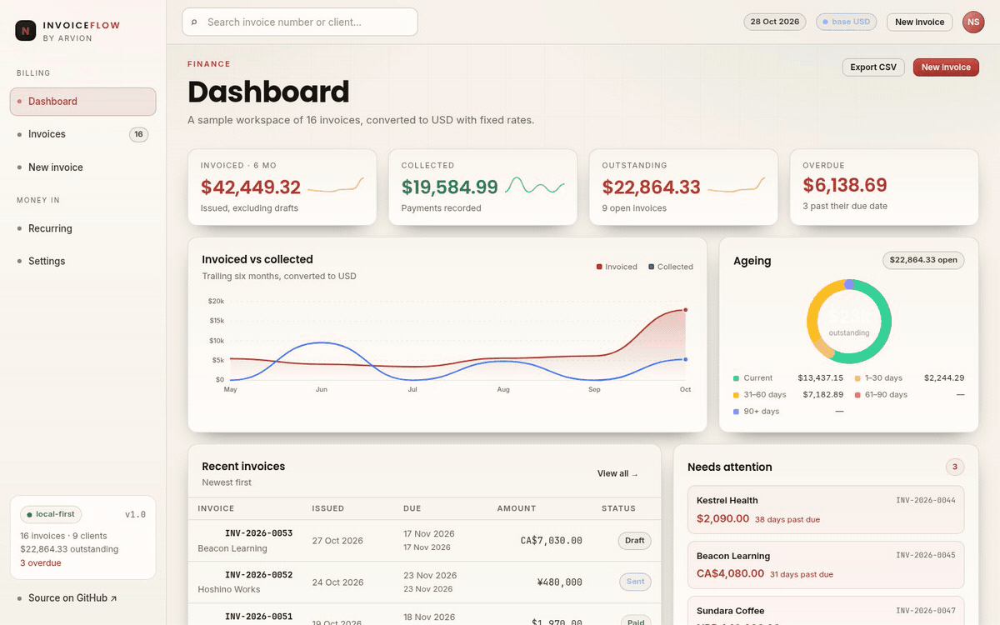
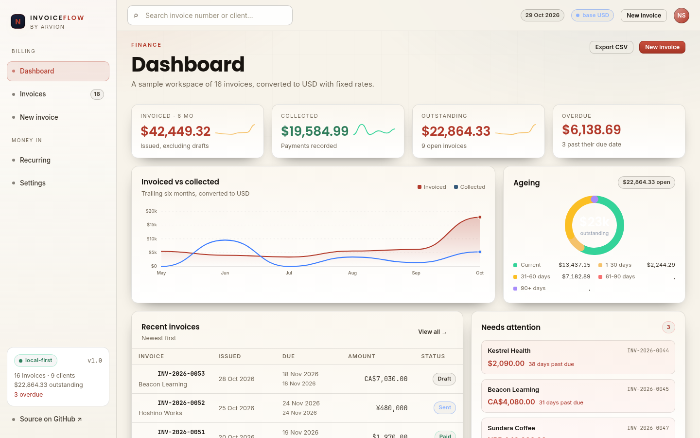
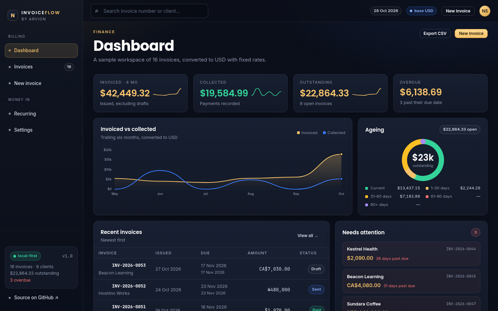

<div align="center">

</div>

<sub>Recorded from the live demo, <a href="docs/demo.mp4">MP4</a> · <a href="docs/screenshot.png">static frame</a></sub>

# InvoiceFlow

Invoicing for a small studio: line items, discounts, tax, several currencies, payments and recurring retainers. It runs entirely in the browser, no server, no build step, no npm install. The part worth reading is the money engine: every amount is an integer number of minor units, discount is applied before tax, and every reported status is derived from the due date and recorded payments rather than stored.

[**Open the live demo**](https://arvion-technology.github.io/labs/demos/invoiceflow/) · [MIT](LICENSE)

---

The demo is seeded with sixteen invoices for nine fictional clients across USD, EUR, GBP, NPR, CAD, AUD and JPY. Change one line item and the totals, the ageing buckets, the dashboard and the printable invoice all move together, because they are all computed by the same functions in `src/`. Your edits stay in `localStorage`.

## What it does

- **Dashboard**: invoiced, collected, outstanding and overdue in a reporting currency, a six-month invoiced-vs-collected chart, an ageing breakdown, recent invoices and the next scheduled retainers.
- **Invoice list**: filter by derived status, client or free text; mark payments; export the current filter as CSV.
- **Create and edit**: line items with quantity, unit price and per-line tax; percentage or fixed discount; tax-inclusive or tax-exclusive prices; live totals and the amount in words.
- **Printable invoice**: a light paper layout that becomes a clean A4 page under `@media print`, ready for the browser's Save as PDF.
- **Recurring schedules**: monthly, quarterly, weekly and yearly rules with month-end clamping, plus suggested overdue reminder text.
- **Settings**: business profile, invoice numbering prefix, default terms, the sample exchange-rate table, JSON backup and restore.

## Screenshots

| Dashboard | Printable invoice |
| --- | --- |
|  |  |

## Architecture

```text
demo/index.html + app.js        rendering, routing, localStorage
   │  imports
   ├── src/money.js             integer minor units, parsing, FX conversion, words
   ├── src/tax.js               discount allocation → tax → totals
   ├── src/invoice.js           numbering, derived status, ageing, reporting
   ├── src/dates.js             calendar dates as YYYY-MM-DD, UTC-stable
   ├── src/recurring.js         schedules with month-end clamping
   └── src/sample.js            the seeded workspace (the only invented numbers)
test/*.test.js                  49 node:test cases against the modules above
```

There is no duplicated business logic in the UI: the invoice list, the totals panel and the printed invoice all call `computeTotals()` from `src/tax.js`. The demo and the tests import the same files.

## Quickstart

```bash
git clone https://github.com/arvion-technology/invoiceflow.git
cd invoiceflow
npm test          # 49 tests, no dependencies, Node 20+
npm run demo      # http://localhost:4173
```

There is nothing to install. `package.json` exists so `npm test` and the CI workflow have a standard entry point.

```bash
npm run shot      # rewrite docs/screenshot.png with headless Chromium
npm run verify    # unit tests plus static checks on the demo bundle
```

## How it works

**Money is an integer, always.** An amount is the number of minor units: `1234` in USD is $12.34, `1234` in JPY is ¥1,234, and `1234` in KWD is 1.234 dinar. The exponent comes from the currency table, not from a hard-coded ×100. Parsing a typed value happens once, in `parseMoney`, and rounds half away from zero; arithmetic never turns the value into a float. Multiplication (price × fractional quantity, amount × exchange rate) goes through `BigInt` and is rounded once at the end, so an invoice with a 2.5-hour line does not inherit a cent of float noise. `formatMoney` is display-only.

**Discount before tax, pro rata.** The order is deliberate and lives in one function, `computeTotals()`:

```text
line gross        = round(unit price × quantity)
subtotal          = Σ line gross
discount          = % of subtotal or a fixed amount capped at it
discount shares   = largest-remainder allocation across lines by gross
taxable line      = line gross − its discount share
tax               = taxable line × rate          (or extracted when prices include tax)
total             = Σ (taxable line + tax)
```

A 10% discount on a taxed line therefore reduces the tax too, which is the client-friendly order. The discount is split by largest remainder so the line shares add back to the discount exactly; a naive `Math.round` per line is the usual way one cent disappears. Tax is rounded per line rather than once on the subtotal. That is the only way to report the right tax for mixed rates, and it means an invoice with two half-cent tax lines can differ by one cent from a flat calculation, the tests pin that behaviour rather than hiding it.

Tax-inclusive prices are supported (`taxInclusive: true`). In that mode the engine extracts the tax instead of adding it: `base = round(gross × 10000 / (10000 + rate))`. Retail prices are normally quoted inclusive, and adding 13% on top of a shelf price is a different invoice.

**Status is derived, never stored.** The only facts are the issue date, the due date, the void/draft flags and the payments. `deriveStatus()` applies a fixed precedence, void, draft, paid, partial, overdue, sent, against an injected `now`. An invoice due on 4 October is not overdue at 23:59:59.999 on 4 October; it becomes overdue one millisecond later. Because the clock is a parameter, the tests can stand on both sides of that boundary without waiting.

**Numbering.** `nextInvoiceNumber()` scans existing numbers for the prefix and year, takes the highest sequence and adds one. Void invoices keep their number: a gap in a tax sequence is a question an auditor will ask, so reusing one is worse than a hole. `parseInvoiceNumber()` and `sequenceGaps()` are there because imports from CSV are where duplicate numbers actually come from.

**Recurring dates are calendar dates.** A retainer anchored on 31 January bills 28 February (29 in a leap year) and then returns to 31 March. The naive "add one month" either overflows into March or leaves the schedule stuck on the 28th. The rule stores the original anchor day and clamps it into the target month; `src/dates.js` keeps dates as `YYYY-MM-DD` strings so no timezone or DST transition can move a billing day. Due dates are issue date plus payment terms, computed in the same calendar space.

**Multi-currency reporting uses one conversion.** Invoice totals stay in their own currency. The dashboard converts at fixed, illustrative mid-market rates quoted per USD with the formula `minorTo = minorFrom × rateTo × 10^expTo / (rateFrom × 10^expFrom)`, rounded once. The demo's rates are frozen on purpose, an offline demo that calls a live FX API is a demo that breaks in a meeting. The screenshot numbers and the sample data are computed from the same records.

## Tests

```bash
npm test
```

49 tests on `node:test`, split by concern:

- `test/money.test.js`: parsing signs, parentheses, thousand separators and half-up rounding; JPY and KWD exponents; BigInt division; largest-remainder allocation; FX conversion in both directions; amount-in-words.
- `test/tax.test.js`: discount before tax, fixed-discount capping, pro-rata shares summing exactly, inclusive-tax extraction, mixed rates, per-line rounding, fractional quantities, invalid inputs.
- `test/invoice.test.js`: numbering and parsing, sequence gaps and duplicates, status precedence, the overdue boundary, overpayment, ageing buckets, monthly revenue, currency conversion.
- `test/recurring.test.js`: month-end and leap-year clamping, quarterly and biweekly rules, payment terms, until/count limits, descriptions, future occurrences.

The demo also has a static check:

```bash
node scripts/serve-check.mjs
```

## Limitations

- It is a local-first demo, not a ledger. There is no authentication, no server, no database and no audit trail beyond the payments array; anyone with the browser profile can edit an invoice.
- The printable invoice is the browser's print dialog, not a generated PDF. That keeps the repository dependency-free; a production system would render the same data with a PDF library.
- Exchange rates are fixed and illustrative. There is no rate history, so converting an old invoice uses today's table.
- Tax rules stop at per-line percentage rates and inclusive/exclusive pricing. There is no reverse charge, no VAT number validation, no rounding rules per jurisdiction and no EU B2B exemption logic.
- Discounts are invoice-level only. A per-line discount or a discount after tax is a different, useful feature this code does not pretend to have.
- Recurring rules generate dates, not invoices. A production version needs a scheduler and idempotency keys so one retainer cannot be issued twice.

## Project layout

```text
invoiceflow/
├── demo/
│   ├── index.html        static app shell
│   ├── app.js            all rendering and interaction
│   ├── arvion.css        shared Arvion design system
│   ├── styles.css        the printable invoice and editor grid
│   └── arvion.js         charts, tables, formatting, storage helpers
├── src/
│   ├── money.js          integer minor units, FX, words
│   ├── tax.js            discount allocation and tax totals
│   ├── invoice.js        numbering, status, ageing, reporting
│   ├── dates.js          timezone-proof calendar date helpers
│   ├── recurring.js      recurring schedules
│   └── sample.js         seeded demo workspace
├── test/                 49 node:test cases
├── scripts/              serve, screenshot, static check
└── .github/workflows/    tests on Node 20 and 22
```

## Credits

Built by [Arvion Technologies](https://arviontech.net) in Kathmandu as part of our open-source [Labs](https://github.com/arvion-technology/labs) series. MIT licensed.
